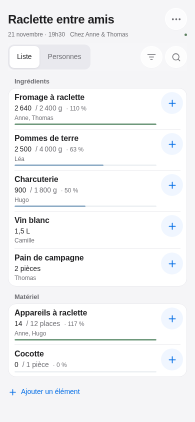
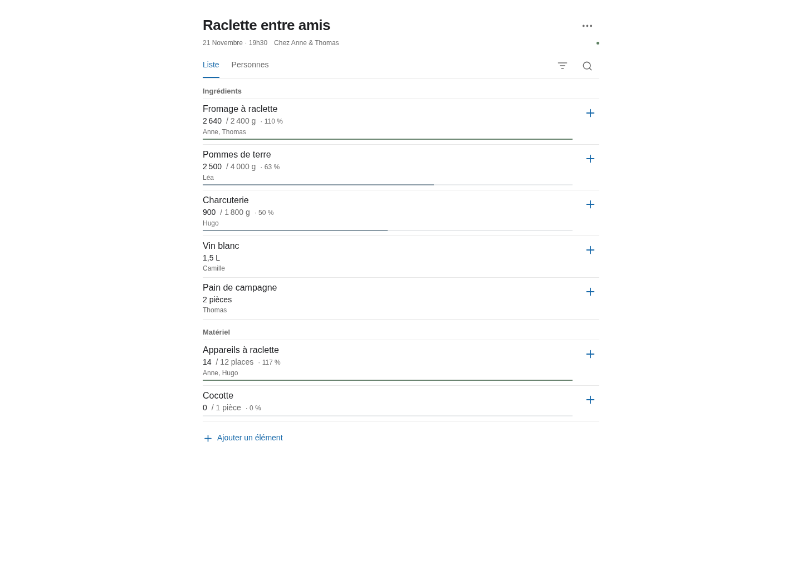

# dumbfood

Une application pour organiser un repas entre amis et savoir qui apporte quoi, pensée d'abord pour le téléphone. Chaque changement apparaît en direct sur les autres appareils.

- L'admin crée les repas, fixe leur date et gère les éléments à apporter.
- Chaque élément a un objectif facultatif, saisi directement : 2 400 g de fromage, 3 L de boissons, 12 places de raclette ou 1 cocotte.
- Les invités ouvrent le lien du repas et indiquent un prénom pour participer. Ils peuvent ajouter un élément libre et modifier les apports de tout le monde.
- Seul l'admin peut renommer ou supprimer un élément, changer son unité ou son objectif, et modifier le titre ou la date du repas.
- Les barres s'arrêtent à 100 %, mais leur texte affiche le total réel, par exemple **110 %**. Les éléments sans objectif affichent simplement leur total et leurs contributeurs.

## Stack

React 19, TypeScript et Vite pour l'interface ; Node.js 24, Express et WebSockets pour l'API et la synchronisation ; SQLite intégré à Node pour les données. Un seul conteneur et un volume persistant suffisent. Aucun service tiers ni compte invité n'est nécessaire.

Voir [l'architecture et les règles de gestion](docs/architecture.md).

## Installation avec Docker

Prérequis : Git, Docker Engine avec Docker Compose v2, et Node.js 24 pour générer la configuration. Une alternative sans Node installé sur l'hôte est donnée plus bas.

```sh
git clone https://github.com/OneFrenchLeft/dumbfood.git
cd dumbfood
node scripts/setup.mjs
docker compose pull
docker compose up -d
```

Compose télécharge l’image publique **`ghcr.io/onefrenchleft/dumbfood:latest`**, publiée par GitHub Actions pour Linux `amd64` et `arm64`. Aucune compilation locale ni connexion à GHCR n’est nécessaire.

Ouvrez **http://localhost:2212/admin**. Le script crée un `.env` privé contenant un mot de passe administrateur aléatoire dans `ADMIN_PASSWORD` et une clé de session dans `SESSION_SECRET`. Consultez ce fichier localement pour vous connecter ; il est exclu de Git et de l'image Docker. Le script refuse d'écraser une configuration existante.

Pour générer `.env` sans Node sur l'hôte, remplacez la commande `node scripts/setup.mjs` par :

```sh
docker run --rm --user "$(id -u):$(id -g)" \
  --mount "type=bind,src=$(pwd),dst=/app" \
  --workdir /app node:24-bookworm-slim node scripts/setup.mjs
```

Créez ensuite un repas, ajoutez les ingrédients et le matériel, puis ouvrez **⋯ → Partager** pour envoyer son lien aux participants. Sur un téléphone du même réseau, utilisez l'adresse IP de l'hôte à la place de `localhost`, par exemple `http://192.168.1.20:2212`.

Le repas s’affiche comme une liste de courses : le **+** d’une ligne ajoute un apport ; toucher la ligne affiche les apports individuels et permet de les modifier. **Ajouter un élément**, en fin de liste, crée un nouvel ingrédient ou matériel. Le menu **⋯** donne accès au prénom, au partage, à l’historique et aux actions d’administration.

### Configuration

Modifiez `.env`, puis appliquez les changements avec `docker compose up -d`.

| Variable | Valeur initiale | Usage |
| --- | --- | --- |
| `ADMIN_PASSWORD` | Générée par le script | Mot de passe admin, au moins 12 caractères |
| `SESSION_SECRET` | Générée par le script | Signature des sessions, au moins 32 caractères |
| `HOST_PORT` | `2212` | Port publié par Docker sur l'hôte |
| `HOST_BIND` | `0.0.0.0` | Interface d'écoute ; `127.0.0.1` derrière un proxy local |
| `DUMBFOOD_IMAGE` | `ghcr.io/onefrenchleft/dumbfood:latest` | Image à utiliser ; peut être fixée à une version ou un tag SHA |
| `COOKIE_SECURE` | `false` | `true` lorsque l'accès se fait en HTTPS |
| `PUBLIC_URL` | Vide | Origine publique exacte derrière un reverse proxy, par exemple `https://repas.example.org` |
| `DEMO_DATA` | `false` | Jeu d'exemple, uniquement sur une base neuve |

Le conteneur écoute toujours sur son port interne `3000`. `HOST_PORT` concerne uniquement le port publié par Docker. La base est enregistrée dans `/app/data/dumbfood.sqlite`, sur le volume nommé `dumbfood_dumbfood-data`.

Pour une installation créée avec une ancienne version de `.env`, définissez `HOST_PORT` si vous souhaitez conserver un port Docker personnalisé : la variable `PORT` ne choisit plus le port publié. Sans `HOST_PORT`, le port publié est désormais `2212`. Le volume de données conserve son nom.

Pour une adresse publique, placez l'application derrière un reverse proxy HTTPS, activez `COOKIE_SECURE=true` et définissez `PUBLIC_URL` avec son origine exacte, par exemple `https://repas.example.org`. Le proxy doit transmettre l'en-tête `Host` et les connexions WebSocket vers `/ws`. Le lien du repas donne accès à ses données : partagez-le avec les personnes invitées.

### Vérifier et arrêter

```sh
docker compose ps
docker compose logs --tail=100 app
curl http://localhost:2212/api/health
docker compose down
```

`docker compose down` conserve le volume. L'option `--volumes` supprime les données.

### Sauvegarder et restaurer

Arrêtez l'application pendant la copie pour conserver ensemble la base et ses éventuels fichiers SQLite WAL. Les commandes suivantes créent une archive du volume sans publier de mot de passe :

```sh
mkdir -p backups
docker compose stop app
docker run --rm \
  --mount type=volume,src=dumbfood_dumbfood-data,dst=/data,readonly \
  --mount "type=bind,src=$(pwd)/backups,dst=/backup" \
  node:24-bookworm-slim tar -czf /backup/dumbfood-data.tar.gz -C /data .
docker compose start app
```

Conservez aussi une copie privée de `.env`. Pour restaurer, arrêtez l'application puis extrayez l'archive dans le volume existant :

```sh
docker compose stop app
docker run --rm \
  --mount type=volume,src=dumbfood_dumbfood-data,dst=/data \
  --mount "type=bind,src=$(pwd)/backups,dst=/backup,readonly" \
  node:24-bookworm-slim sh -c 'rm -f /data/dumbfood.sqlite /data/dumbfood.sqlite-wal /data/dumbfood.sqlite-shm && tar -xzf /backup/dumbfood-data.tar.gz -C /data'
docker compose start app
```

Si vous changez le nom du projet Compose, adaptez le nom du volume dans ces commandes. Effectuez une sauvegarde avant une mise à jour :

```sh
git pull --ff-only
docker compose pull
docker compose up -d
```

### Construire l'image localement

Le fichier d'override active la construction depuis les sources et utilise l'image locale `dumbfood:local` :

```sh
docker compose -f compose.yaml -f compose.build.yaml up -d --build
```

### Publication de l'image sur GitHub

Le workflow GitHub Actions exécute les tests, compile l'application, puis publie l'image sur GitHub Container Registry lors d'un push sur `main`, d'un tag `v*` ou d'un lancement manuel. Les images ciblent Linux `amd64` et `arm64`. Sur `main`, le tag `latest` suit la dernière publication ; chaque publication reçoit aussi un tag `sha-<commit-court>`. Un tag Git `v1.2.3` produit les tags d'image `1.2.3` et `1.2`. Définissez `DUMBFOOD_IMAGE` pour fixer une version précise.

L’image officielle est publique et son démarrage est vérifié automatiquement avec Compose sur le port `2212` après chaque publication.

## Développement

Prérequis : Node.js 24 ou plus récent.

```sh
npm ci
npm run setup
npm run dev
```

Dans un deuxième terminal :

```sh
npm run dev:ui
```

Ouvrez l'URL Vite affichée, généralement `http://localhost:5173`. Vite relaie l'API et les WebSockets vers le serveur sur `3000`. Hors Docker, le serveur conserve son port par défaut `3000` ; `HOST_PORT` n'a pas d'effet. `PORT` permet de changer ce port serveur, et `DB_PATH` de choisir le fichier SQLite.

```sh
npm test
npm run build
npm start
```

Après la compilation, le serveur sert aussi l'interface sur le port `3000`.

Pour préparer une installation de démonstration, définissez `DEMO_DATA=true` dans `.env` avant le premier démarrage avec une base vide. Le repas d'exemple est accessible à `/e/demo-raclette-entre-amis`. Ce réglage n'ajoute rien à une base déjà remplie.

## Captures

Les captures utilisent le repas de démonstration.

Pour les reproduire après `npm ci`, installez Chromium (`npx playwright install chromium`) puis lancez `npm run screenshots`. Le script démarre une base d’exemple temporaire et prend des captures en 390 × 844 et 1 440 × 1 040, sans toucher aux vrais repas. Un Chromium système peut être sélectionné avec `CHROMIUM_PATH=/chemin/vers/chromium` ; `/usr/bin/chromium` est détecté automatiquement.

Avec ce même navigateur, `npm run test:browser` vérifie les parcours admin et invité sur ordinateur et mobile, la mise à jour entre deux navigateurs, les filtres, les formulaires et l’affichage de 320 à 1 440 pixels. Ce contrôle utilise aussi une base temporaire.

| Mobile | Ordinateur |
| --- | --- |
|  |  |

## Construction derrière un proxy avec une autorité de certification privée

Le Dockerfile accepte un secret BuildKit facultatif `proxy_ca`. La CA reste dans le montage temporaire de la construction et n'est pas copiée dans l'image :

```sh
docker build --secret id=proxy_ca,src=/chemin/vers/ca.pem -t dumbfood:local .
docker compose -f compose.yaml -f compose.build.yaml up -d --no-build
```
