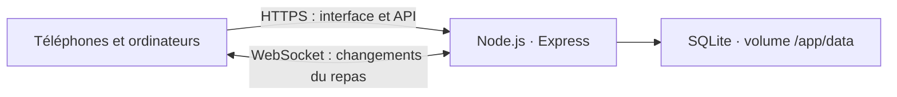

# Architecture de dumbfood

dumbfood réunit l’interface, l’API et la synchronisation dans un seul service Docker. L’installation fonctionne sans service externe : les repas sont enregistrés dans une base SQLite conservée dans un volume.

## Stack

| Couche | Technologie | Rôle |
| --- | --- | --- |
| Interface | React, TypeScript, Vite | Vues adaptées au téléphone, formulaires et progression |
| Serveur | Node.js 24, Express 5 | API JSON, contrôles d’accès et fichiers de l’interface |
| Validation | Zod | Validation des données reçues avant écriture |
| Données | SQLite avec `node:sqlite` | Événements, participants, besoins, apports et historique |
| Temps réel | WebSockets avec `ws` | Notification des changements pour chaque repas |
| Installation | Docker Compose | Service unique, vérification de santé et volume persistant |

Le même serveur distribue l’interface et expose `/api`, ce qui conserve les requêtes sur une seule origine. Un reverse proxy peut fournir HTTPS devant le port 3000 et doit transmettre les connexions WebSocket.

## Modèle de données

| Entité | Champs principaux | Relation |
| --- | --- | --- |
| Événement | Titre, date, lieu, adresse, description, lien de partage, état archivé, version | Possède les participants et les éléments |
| Participant | Identifiant stable, prénom | Appartient à un événement |
| Élément | Nom, catégorie, unité, objectif facultatif, version | Appartient à un événement |
| Apport | Personne, quantité, capacité éventuelle, note, version | Relie un participant à un élément du même événement |
| Historique | Auteur déclaré, description, date | Appartient à un événement |

Les catégories sont `ingredient` et `equipment`. Les unités sont les grammes (`g`), litres (`L`), portions (`portion`), places (`place`) et pièces (`piece`).

L’adresse est facultative et distincte du nom du lieu. Lorsqu’elle est renseignée, l’interface propose un lien Maps contenant cette adresse encodée. Les nouvelles dates sont saisies en format 24 h, avec des minutes limitées à `00`, `15`, `30` et `45`. Les anciens horaires restent conservés si l’admin ne modifie pas la date ou l’heure.

Le prénom du participant désigne la personne qui apporte. L’auteur de la modification provient de la session de la personne qui utilise l’application. Thomas peut ainsi enregistrer l’apport d’Anne tout en signant la modification avec son propre prénom.

## Objectifs et calculs

L’administrateur saisit directement l’objectif d’un élément. Cet objectif ne dépend pas d’un nombre de convives. Une valeur `null` représente un élément sans objectif.

- Avec un objectif : l’interface affiche le total, l’objectif et le pourcentage réel. La largeur de la barre est plafonnée à 100 %, et le texte peut afficher 110 % ou davantage.
- Sans objectif : l’interface affiche le total et les personnes qui apportent ; aucun pourcentage n’est calculé.
- Pour les unités ordinaires : le total est la somme des quantités des apports.
- Pour les places : chaque apport décrit un nombre d’appareils et leur capacité. Sa contribution au total vaut `quantité × capacité`.

Exemple : un appareil de 6 places et un appareil de 8 places couvrent 14 places. Pour un objectif de 12 places, la progression affichée est de 117 %.

Les pourcentages sont calculés à partir des apports, séparément pour chaque élément. Les grammes, litres et places ne sont pas additionnés dans un pourcentage global.

L’API valide les quantités et objectifs : ils sont positifs et entiers pour les grammes, portions, places et pièces ; les litres acceptent des décimales. L’interface accepte la virgule pour les litres et la convertit avant l’envoi à l’API. Les commandes de quantité avancent ou reculent d’une unité, y compris pour les litres.

## Droits et partage

| Action | Administrateur connecté | Invité ayant indiqué son prénom |
| --- | --- | --- |
| Créer ou gérer les événements | Oui | Non |
| Modifier le titre, la date, le lieu, l’adresse ou la description | Oui | Non |
| Ajouter un élément | Oui | Oui, sans objectif |
| Modifier le nom, l’unité ou l’objectif d’un élément | Oui | Non |
| Supprimer un élément et ses apports | Oui | Non |
| Ajouter, modifier ou supprimer un apport pour toute personne | Oui | Oui |

Ces règles sont appliquées par le serveur. Masquer un bouton dans l’interface ne constitue pas le contrôle d’accès.

Chaque événement possède un jeton aléatoire utilisé dans son lien `/e/:jeton`. Ce lien donne accès au repas ; il est destiné aux personnes invitées. Le prénom sert à signer les modifications et ne constitue pas une identité vérifiée.

La connexion administrateur utilise le mot de passe configuré à l’installation. Les sessions sont signées avec un secret serveur et placées dans des cookies `HttpOnly`, avec `SameSite=Lax`. La configuration `COOKIE_SECURE=true` est adaptée à une installation servie en HTTPS. Le mot de passe et le secret restent dans l’environnement du serveur.

## Enregistrement et temps réel

1. L’interface envoie une modification à l’API avec la version connue de l’enregistrement.
2. Le serveur vérifie la session, l’événement concerné et les valeurs saisies.
3. Il enregistre le changement et l’historique dans une transaction SQLite.
4. Il notifie les connexions WebSocket abonnées à cet événement avec un message `changed`.
5. Les clients rechargent l’état du repas depuis l’API.

Le canal `/ws?event=:jeton` diffuse uniquement les changements du repas associé. Les données restent obtenues depuis l’API, qui fournit les éléments, participants, apports et les 50 dernières entrées de l’historique.

Les événements, éléments et apports possèdent un numéro de version. Une modification fondée sur une ancienne version reçoit une réponse `409 Conflict`. L’interface peut alors recharger les données et demander de recommencer avec l’état courant, sans écraser silencieusement le travail d’une autre personne.

## Persistance et exploitation

SQLite utilise les clés étrangères, le mode WAL et un délai d’attente pour les écritures concurrentes. Le volume Docker contient la base et ses fichiers associés ; remplacer le conteneur conserve les repas.

Le schéma v2 ajoute la colonne d’adresse avec une valeur vide pour les événements existants. La migration est idempotente et ne réécrit ni les horaires ni les anciennes quantités.

Cette architecture vise une instance de l’application. Le serveur garde les connexions WebSocket en mémoire, et le volume SQLite est local à l’installation. Une future exécution sur plusieurs instances demanderait une base et un mécanisme de diffusion partagés.

Pour une sauvegarde par copie de fichiers, arrêter le service avant de copier le contenu du volume, puis le redémarrer. Cette procédure préserve un ensemble cohérent comprenant la base et ses éventuels fichiers WAL. Le README décrit les commandes d’installation, de sauvegarde et de mise à jour.
